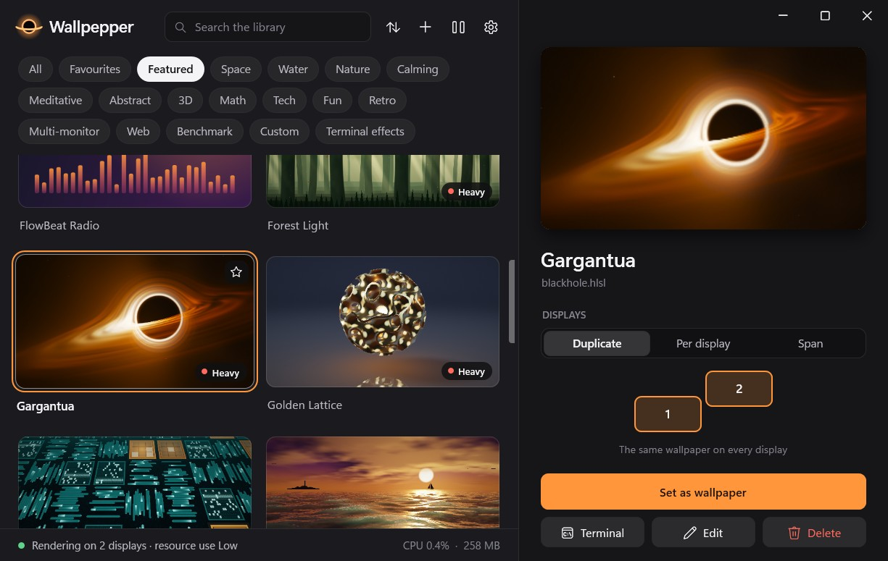
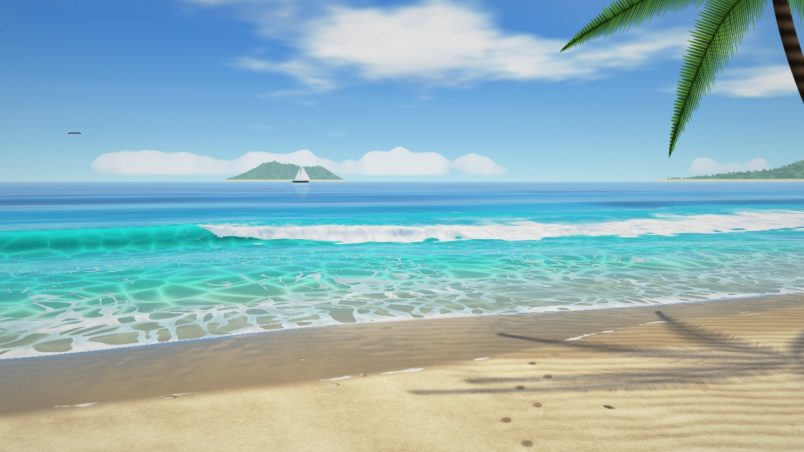
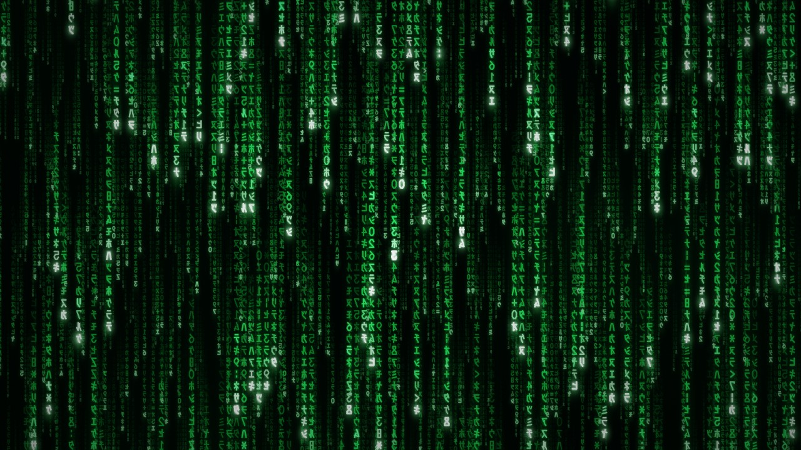
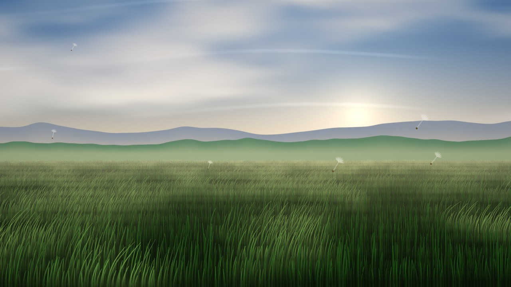
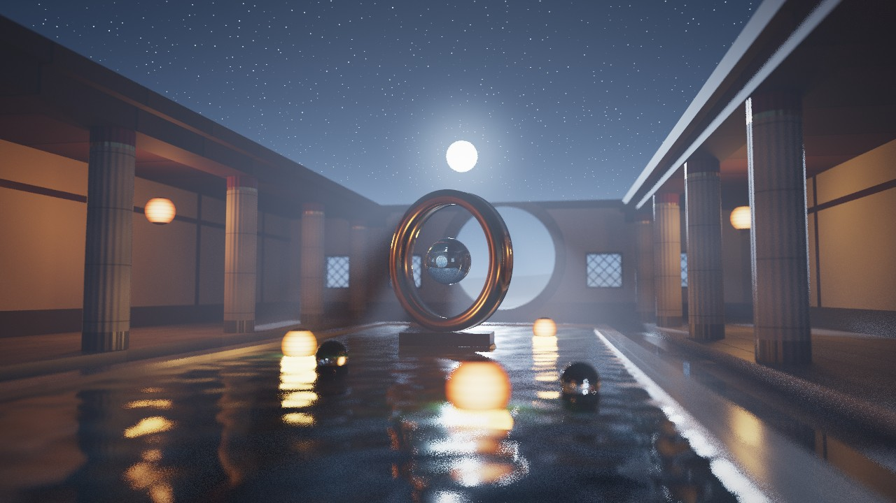
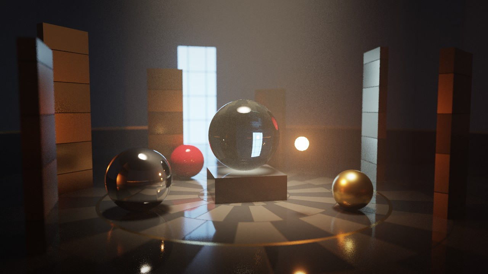
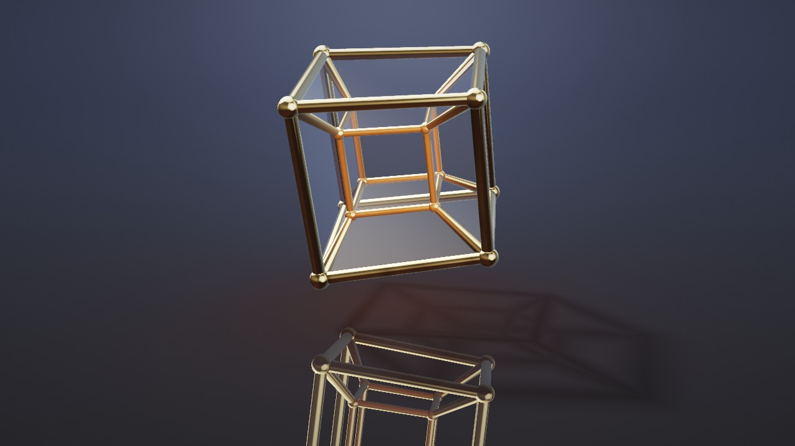
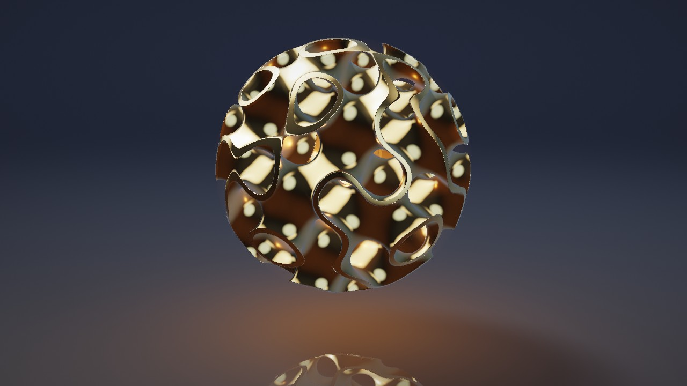

# Wallpepper

Animated shader wallpapers for Windows (and, experimentally, Linux), in a single small executable.

Wallpepper runs **Windows Terminal pixel shaders** as your desktop background. Any `.hlsl` file that works with
Terminal's `experimental.pixelShaderPath` works in Wallpepper, and every shader in the library can be sent back to
Terminal with one click.



| | | |
| --- | --- | --- |
|  |  |  |
|  |  |  |
|  |  |  |

The path-traced scenes are shown converged; live they render a few samples per frame and look grainier.

## What it does

- **Library**: bundled shaders with search, tag filters, favourites, live preview, add / edit / delete, hot reload
  when you save a file in your editor. See the [catalogue](docs/SHADERS.md).
- **Settings for every shader**: each numeric `#define` in a shader becomes a slider, toggle, stepper or colour
  picker. No recompiling by hand.
- **Multi-monitor**: the same wallpaper on every display, a different one per display, or one image spanning all
  of them. Some shaders are written for spanning (koi, comets and a game of pong that cross from screen to screen).
- **Light on the machine by default**: one render thread and Direct3D 11. A "Resource use" level (Low by default:
  about 15% of the GPU, at most 30 frames per second) fits render scale and frame rate to every shader and display
  from its measured GPU cost, and heavy shaders switch to cheaper settings they declare themselves. Rendering
  pauses when a window covers the desktop, the display is off, the session is locked or battery saver is on.
- **Filters**: brightness, contrast, saturation, colour temperature, blur and vignette per display, applied after
  the shader.
- **Web wallpapers**: a web page can be the wallpaper too. One is bundled: FlowBeat, an internet radio with
  visualisations. "Interact" lifts the page in front of your windows so you can press play, then sends it back.
- **GPU benchmark (experimental)**: a path tracer with a fixed workload produces a score on a provisional scale:
  10000 stands for 60 frames per second at 4K, an estimate for an RTX 5090. No such card has been measured yet.
  See [docs/BENCHMARK.md](docs/BENCHMARK.md).
- **In the browser**: the same benchmark runs on any device with WebGL 2 at
  <https://denniswalkewitz.github.io/Wallpepper/> (macOS, phones, tablets; nothing to install). Browser scores
  include browser overhead and are close to, but not strictly comparable with, the native ones. The
  [shader gallery](https://denniswalkewitz.github.io/Wallpepper/gallery.html) shows the bundled wallpapers live.

## Install (Windows 10 / 11)

Requires the [.NET 10 Desktop Runtime](https://dotnet.microsoft.com/download/dotnet/10.0).

Download `Wallpepper.exe` from the [latest release](https://github.com/DennisWalkewitz/Wallpepper/releases/latest)
and run it. On first start it offers to install itself for the current user (no administrator rights), adds a tray
icon and seeds the shader library. Everything is controlled from the tray icon or the library window.
Wallpepper checks the releases of this repository once a day and offers to update itself; the download is verified
against the release's `SHA256SUMS.txt`. The check can be switched off in the settings.

Shortcuts: `Ctrl+Alt+Win+Right / Left` next / previous shader, `Ctrl+Alt+Win+P` pause.

### Build it yourself

```
windows\build.cmd          rem needs the .NET 10 SDK, output: windows\dist\Wallpepper.exe
windows\check-shaders.cmd  rem compiles every shader and measures its GPU time
windows\test.cmd           rem unit tests
windows\selftest.cmd       rem applies every wallpaper on the real desktop and checks that frames arrive
```

## Linux (Ubuntu 24.04, experimental)

A small native build without a graphical library manager: it lists, checks, renders and runs shaders, can act as
a wallpaper on X11 sessions, and runs the benchmark on headless machines. So far it has only been run on Mesa's
software renderer and under Xvfb: no real GPU and no real desktop session yet. A prebuilt
`wallpepper-linux-x64.tar.gz` is attached to each release. See [docs/LINUX.md](docs/LINUX.md).

```
sudo apt install build-essential cmake libx11-dev libxrandr-dev
cmake -S linux -B build && cmake --build build
build/wallpepper check
build/wallpepper run wind --window
build/wallpepper bench
```

## Writing shaders

One file, one pixel shader, no build step. [docs/SHADER-GUIDE.md](docs/SHADER-GUIDE.md) describes the contract,
how settings are declared, the multi-monitor extension and the portable subset that keeps a shader working on
both platforms. On Linux, `wallpepper render` writes a frame of any shader to a PNG, also on machines without a GPU.

## Layout

```
shaders/   the bundled library (HLSL, Windows Terminal compatible)
windows/   the Windows app (C#, WPF, Direct3D 11)
linux/     the Linux build (C++, OpenGL via EGL / X11)
web/       browser benchmark and shader gallery (static site for GitHub Pages; web/shaders/ is generated)
tools/     script that generates the shader catalogue
docs/      guides, benchmark description, screenshots
```

## Licence

MIT, see [LICENSE](LICENSE). Some bundled shaders come from other authors under their own terms, see
[THIRD-PARTY-NOTICES.md](THIRD-PARTY-NOTICES.md).
